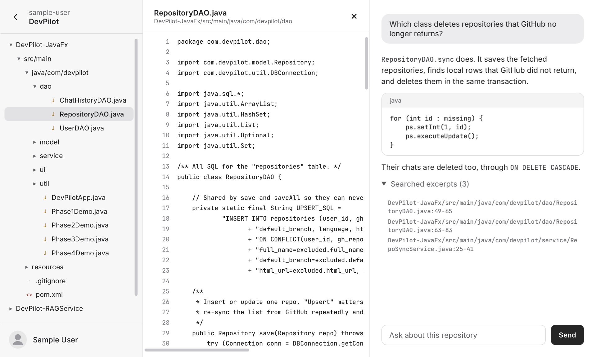

# DevPilot

DevPilot is a desktop app for asking questions about your GitHub repositories in plain English. It finds the relevant code and answers from it, using Retrieval-Augmented Generation (RAG).

It has two parts that communicate only over HTTP and JSON:

- **`DevPilot-JavaFx`**: the desktop app (JavaFX, JDBC, SQLite)
- **`DevPilot-RAGService`**: the RAG service (Python, FastAPI, LangChain, ChromaDB, Groq)



*Screenshots show sample data.*

## Features

- GitHub login with the OAuth Device Flow
- Public and private repositories, with filtering
- Saved repositories are still listed when GitHub can't be reached
- Create or re-create embeddings for a repository, with the date and commit shown
- Questions answered from the repository's code, with the searched excerpts listed
- Conversations saved per user and repository
- File tree and read-only code viewer, matching the embedded commit

## Requirements

- Java 21 and Maven
- Python 3.13
- A GitHub account
- A [Groq API key](https://console.groq.com/keys)
- Internet access. The first embedding downloads a model of about 80 MB

Developed and run on macOS; other systems have not been tested.

## Setup

### 1. RAG service

```bash
cd DevPilot-RAGService
python3.13 -m venv .venv
.venv/bin/pip install -r requirements.txt
```

Create a file named `.env` in `DevPilot-RAGService`:

```text
GROQ_API_KEY=your-key-here
```

Git ignores this file. Never commit it. To use another Groq model, add `GROQ_MODEL=model-name`.

### 2. GitHub OAuth App (optional)

The app includes a client ID. To use your own, create an OAuth App on GitHub, turn on **Enable Device Flow**, and set `github.client-id` in `DevPilot-JavaFx/src/main/resources/application.properties`. No client secret is needed.

## Run

Start the RAG service first, from `DevPilot-RAGService`:

```bash
.venv/bin/uvicorn main:app --host 127.0.0.1 --port 8000
```

Then, in another terminal, from `DevPilot-JavaFx`:

```bash
mvn -q compile javafx:run
```

## Use

1. Log in with GitHub and enter the code shown.
2. Select a repository and click **Open chat**.
3. Click **Create vector embeddings** the first time.
4. Ask a question, or open files from the tree on the left.
5. Click your name at the bottom left to see when the embeddings were made or to re-create them.

## Project structure

```text
DevPilot-JavaFx/
  pom.xml
  src/main/java/com/devpilot/
    DevPilotApp.java    entry point and navigation
    model/              User, Repository, ChatMessage
    dao/                all SQL, one class per table
    service/            GitHub and RAG service clients
    ui/                 JavaFX screens and components
    util/               database, HTTP, JSON and settings helpers
  src/main/resources/   settings, schema, styles, fonts, logo
DevPilot-RAGService/
  main.py               API endpoints
  models/schemas.py     request and response formats
  services/             the RAG pipeline
docs/                   documentation and images
```

`Phase1Demo` to `Phase4Demo` are console programs kept from the early development steps.

## Documentation

- [Architecture](docs/architecture.md)
- [Database](docs/database.md)
- [RAG service API](docs/api.md)

## Privacy and security

- The GitHub token is stored **unencrypted** in `devpilot.db`. Its `repo` scope also allows writing; DevPilot only reads. Logging out removes it from the computer. To revoke it, use GitHub's **Settings > Applications**.
- Your question and the matching code excerpts, including private code, are sent to Groq.
- Indexed code stays in `DevPilot-RAGService/chroma_data/`. Delete that folder while the service is stopped to clear it.
- Common secret files, such as `.env` and key files, are not indexed. Secrets inside ordinary code files can be.
- The service has no login of its own, so run it on `127.0.0.1` only.

## Limitations

- Each question is answered separately; earlier messages are not sent to the model.
- Answers can be wrong or incomplete.
- A repository missing from a GitHub sync is removed locally, along with its chats.
- Notebooks, CSV and SVG files, dependency folders, and files over 200 KB are not indexed.
- The code viewer has no syntax colors or copying.
- There are no automated tests yet.
