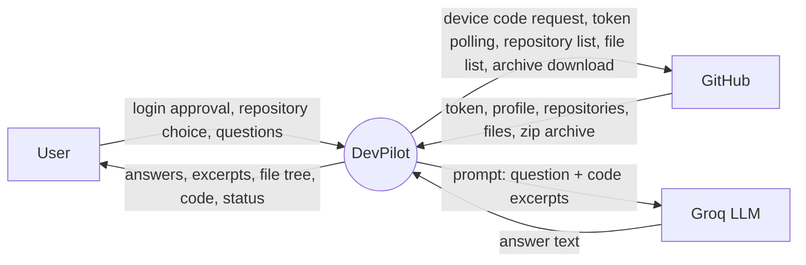
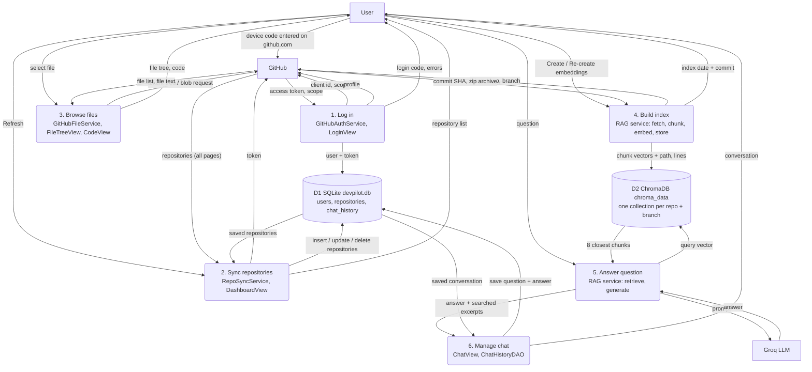
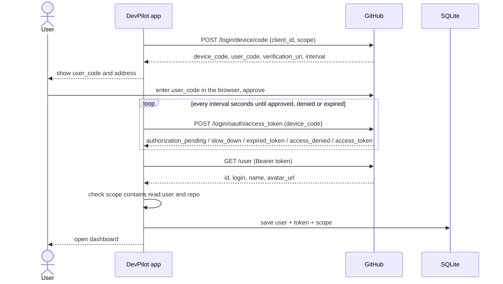
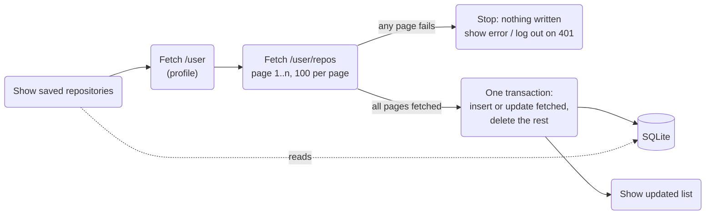
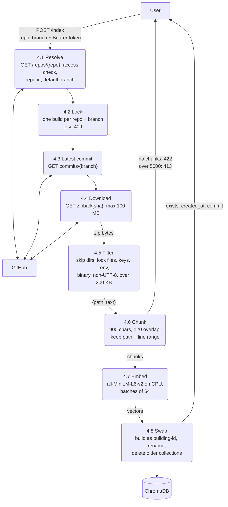
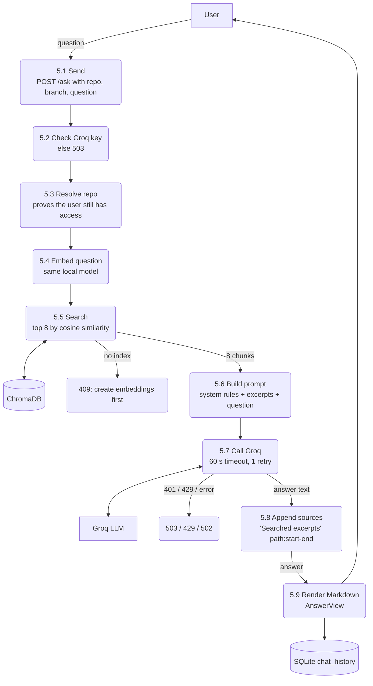

# Data Flow Diagrams

The diagrams use [Mermaid](https://mermaid.js.org/), which GitHub draws automatically. They follow the code in `DevPilot-JavaFx` and `DevPilot-RAGService`.

Notation: rectangles are external entities, rounded boxes are processes, cylinders are data stores, and arrows are labelled with the data that moves.

## Level 0: context diagram

DevPilot is one system. The user talks to it; it talks to GitHub and Groq.

## Level 1: main processes

The two programs communicate only with HTTP and JSON.

## Level 2: process 1, GitHub login (Device Flow)

## Level 2: process 2, repository sync

## Level 2: process 4, build the index

## Level 2: process 5, answer a question

## Data dictionary

| Data | Where it lives | Fields |
|---|---|---|
| User | `users` table | `github_id`, `github_username`, `display_name`, `avatar_url`, `access_token`, `token_scope` |
| Repository | `repositories` table | `user_id`, `gh_repo_id`, `owner`, `name`, `full_name`, `is_private`, `default_branch`, `language`, `html_url`, `description` |
| Chat message | `chat_history` table | `user_id`, `repo_id`, `question`, `answer`, `timestamp` |
| Chunk | ChromaDB collection | text (path + code), vector (384 numbers), `path`, `start`, `end` |
| Index info | ChromaDB collection metadata | `commit`, `created_at` |
| Ask request | HTTP JSON | `repo`, `branch`, `question` |
| Index status | HTTP JSON | `exists`, `building`, `created_at`, `commit` |
