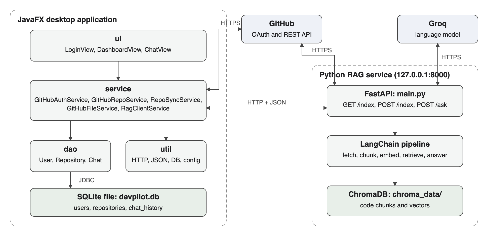
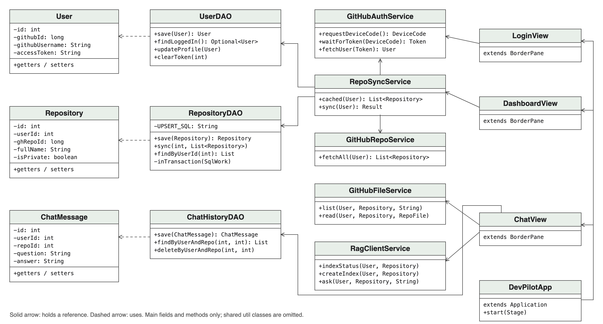
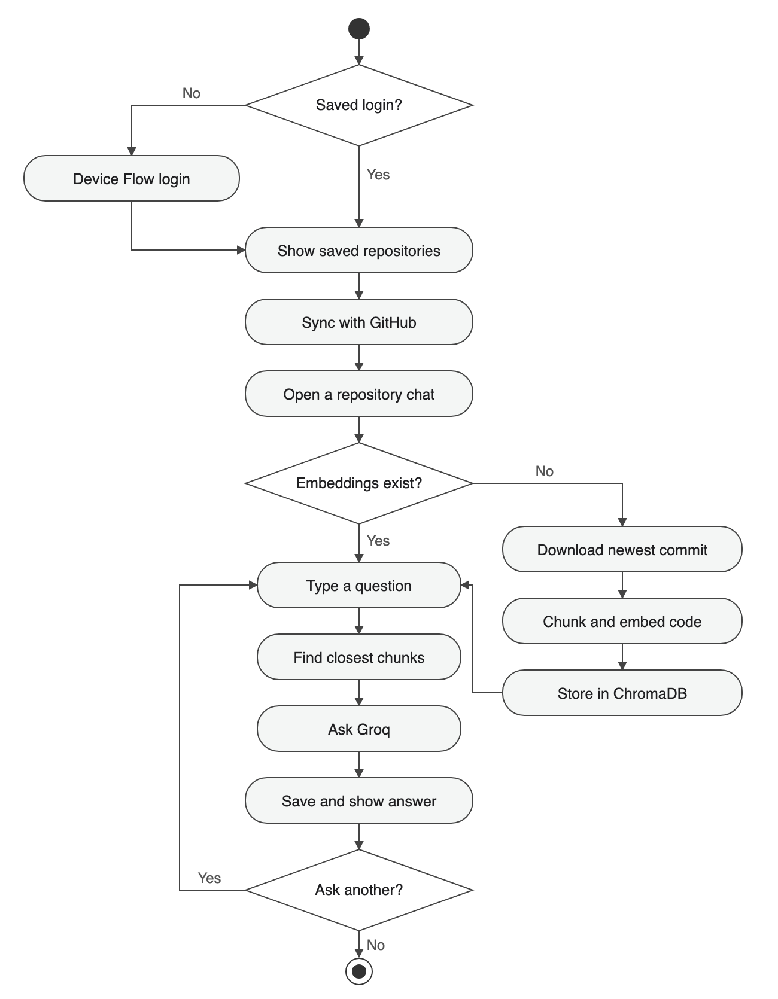

# Architecture

## Layers of the desktop app

| Package | Responsibility |
|---|---|
| `ui` | Screens and components. No SQL |
| `service` | Talks to GitHub and the RAG service. `RepoSyncService` also calls the DAOs |
| `dao` | All SQL, one class per table |
| `model` | Plain data objects passed between layers |
| `util` | Database connections, HTTP, JSON and settings |

`DevPilotApp` creates the services, keeps the logged-in user, and decides which screen is shown. Screens receive what they need through their constructors.

## Threads

Slow work runs through `ui/Background`, which wraps a JavaFX `Task` in a daemon thread. Its callbacks run on the JavaFX thread, the only one allowed to change the screen. Leaving a screen cancels its tasks.

## Login

`GitHubAuthService` uses the OAuth Device Flow: it requests a code, the user enters it on GitHub, and the app polls until the login is approved, cancelled or expired. GitHub reports polling errors with HTTP status 200, so the JSON is checked as well.

## Repository sync

Saved repositories are shown first. All pages are then fetched from GitHub before anything is written. One transaction inserts or updates the fetched repositories and deletes the rest.

## RAG pipeline

| Step | File | What it does |
|---|---|---|
| Fetch | `github_fetcher.py` | Checks access, downloads the commit, filters files |
| Chunk | `chunker.py` | Splits code into overlapping pieces with LangChain |
| Embed | `embedder.py` | Makes vectors locally with all-MiniLM-L6-v2 |
| Store and search | `vector_store.py` | Keeps vectors in ChromaDB, finds the 8 closest chunks |
| Answer | `llm_client.py` | Builds the prompt and calls Groq |
| Order | `rag.py` | Runs the steps |

New embeddings are built under a temporary name and swapped in only when complete, so a failed build keeps the old ones. Access to the repository is checked with GitHub on every request.

