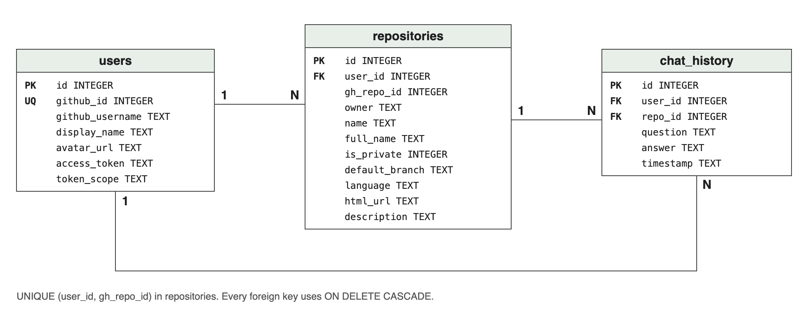

# Database

The desktop app keeps one SQLite file, `devpilot.db`, in the folder it is run from. Tables are created from `schema.sql` at startup. Vectors are not stored here; they are in ChromaDB.

| Table | Holds | Rules |
|---|---|---|
| `users` | GitHub profile, token and scope | `github_id` is unique |
| `repositories` | Repository details | `(user_id, gh_repo_id)` is unique |
| `chat_history` | One question and answer per row | Belongs to a user and a repository |

Foreign keys use `ON DELETE CASCADE`. SQLite applies them only when `PRAGMA foreign_keys = ON` is set, which `DBConnection` does for every connection.

SQLite has no boolean type, so `is_private` is 0 or 1. `timestamp` is ISO 8601 text. Conversations are read in `id` order.
